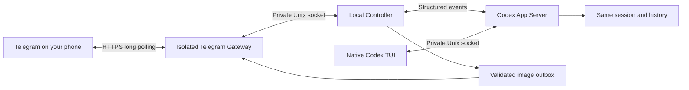
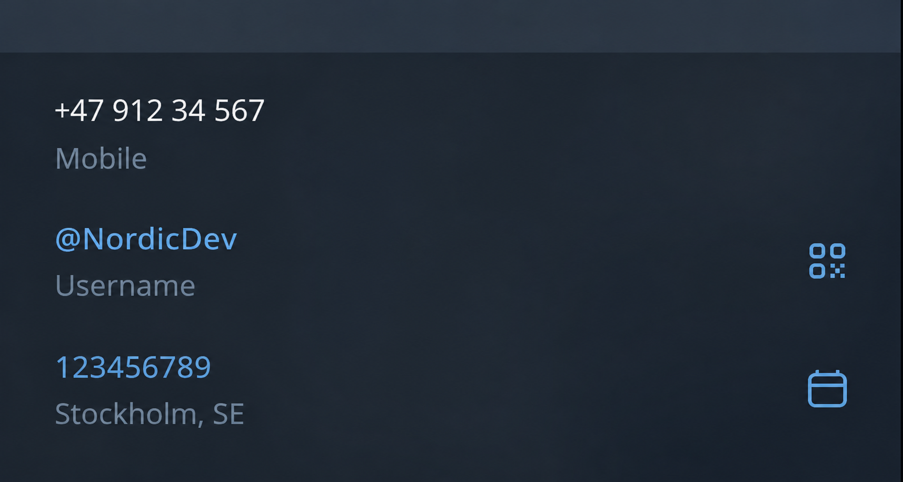
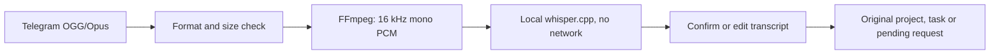

<div align="center">

# Codex Telegram Bridge

**Your Codex session. Your computer. A Telegram remote.**

[](pyproject.toml)
[](#requirements)
[](#how-it-connects)
[](#local-voice)

[Quick Start](#quick-start) · [Telegram Commands](#telegram-commands) · [Images & Reviews](#images--reviews) · [Troubleshooting](#troubleshooting) · [Security](SECURITY.md)

</div>

Send tasks from your phone, receive Codex replies and generated images, and continue working in the **native Codex terminal interface with the same history**.

> [!IMPORTANT]
> **Working prototype; full acceptance is still pending.** Tested with **Codex CLI 0.160.1**. Remote `/clear` and mirroring native `/status` output are unsupported. See [known limits](#known-limits) and [test evidence](docs/acceptance.md).

## At a glance

| Feature | How it works |
|---|---|
| 🖥️ Shared session | Native Codex TUI and Telegram connect to one local App Server |
| 📂 Multiple projects | One registered directory → one active session → one FIFO queue |
| 💬 Final replies | Separate messages with task IDs; long answers are split |
| 🎨 Generated images | Validated images from Codex events are exported and delivered |
| ✅ Interactive control | Requests and one-use buttons stay bound to their original project |
| 🎤 Local voice | FFmpeg + whisper.cpp, followed by transcript confirmation |
| 🔒 Restricted Gateway | Bubblewrap isolation, private Unix sockets, no public server |
| ♻️ Recovery | SQLite queues and session bindings survive restarts; uncertain tasks are blocked |

**Bot controls and setup are in English.** Codex replies, questions, option labels and voice transcripts keep their original language. Forwarding messages does not invoke a model. Codex tasks use your existing ChatGPT authorization and its normal usage limits; the bridge adds no paid AI API or cloud transcription service.

## How it connects



The App Server executes turns and writes history. The terminal is a client of that same runtime. The bridge does not start a separate Codex process for every message or synchronize two different conversations.

## Requirements

- **Arch Linux / CachyOS**, Python ≥3.12 and `uv`.
- **Codex CLI 0.160.1**, already signed in through ChatGPT.
- `bubblewrap`, `ffmpeg` / `ffprobe`, `prlimit` from `util-linux`.
- `systemd --user` for background services.
- `tmux` for the optional managed terminal.
- For voice: local `whisper-cli` and a **multilingual** model. CMake and a C++ compiler are needed to build it.

A different Codex version is rejected until its protocol compatibility is verified. Wayland / Hyprland works through the regular terminal; no desktop automation is required.

## Quick Start

### 1. Prepare your computer

Download or clone this repository, enter its directory, then install any missing dependencies:

```bash
sudo pacman -S --needed python uv bubblewrap ffmpeg util-linux tmux cmake base-devel
codex --version
codex login status
```

The login check must confirm ChatGPT authentication. Your existing Codex settings, credentials, `AGENTS.md` and project files are kept.

### 2. Create your Telegram bot

1. Open **@BotFather** in Telegram and run `/newbot`.
2. Choose your bot's name and username.
3. Keep the token for the local setup prompt. **Do not put it in a shell command, repository or issue.**
4. Open your new bot and send `/start` from your own account.

<details>
<summary><strong>What is my Telegram User ID?</strong></summary>

A **Telegram User ID** is the unique numeric identifier of your account. The bridge uses it to authorize you. It is different from your phone number and `@username`.

<p align="center">
  
</p>

In this illustration, `123456789` is an example ID. Use your own value, not this example, the phone number or `@NordicDev`.

**You do not need another bot to find your ID.** Leave the numeric ID prompt empty in setup. It will show a one-time pairing code; send that code to your bot and confirm the ID in your terminal. The standard Telegram profile may not display a User ID field like this illustration.

</details>

### 3. Optional: prepare local voice

If you want voice enabled during the first setup, build whisper.cpp **before** running the installer:

```bash
bash scripts/build-whisper.sh
```

This installs a CPU binary under `~/.local/share/codex-telegram-bridge/bin/`. Setup will offer the multilingual `small` model download if it is missing. Without voice configured, text tasks still work.

### 4. Run the installer

```bash
bash scripts/install.sh
```

The wizard checks dependencies and Codex authentication, then asks for:

| Prompt | What to enter |
|---|---|
| `Telegram Bot Token` | Your BotFather token; input is hidden |
| `numeric Telegram User ID` | Your numeric ID, or Enter for one-time pairing |
| `Send Codex final replies and generated images…` | `y` to receive final answers and built-in generated images |
| `Project ID` | A short local identifier, for example `game` |
| `Project name` | A display name, for example `GameProject` |
| `Local project directory` | Your existing project directory |
| Whisper model, if enabled | A multilingual model; `.en` models are rejected |
| `Connect the bridge when launching codex?` | `y` to enable automatic routing in registered projects |

Setup validates the token and your private chat. It writes private configs with **0600** permissions in **0700** directories, prepares user services and preserves existing settings on repeat runs. Personal values are entered locally; repository examples contain placeholders.

<details>
<summary><strong>If the launchers are not on PATH</strong></summary>

The installer places `codex-bridge` and `codex-tg` under `~/.local/bin`.

For the current Bash/Zsh terminal:

```bash
export PATH="$HOME/.local/bin:$PATH"
```

For Fish:

```fish
fish_add_path "$HOME/.local/bin"
```

You can also invoke `~/.local/bin/codex-bridge` directly.

</details>

### 5. Start the services

```bash
systemctl --user enable --now codex-telegram-bridge
systemctl --user status codex-telegram-bridge codex-telegram-controller
```

In Telegram, open **Menu** or send `/start`, then select your project with `/projects`.

### 6. Open the same session on your computer

From a registered project directory:

```bash
codex-tg
```

Or select a project explicitly:

```bash
codex-tg game
```

If you enabled shell routing, open a new terminal and use **`codex` without arguments** in that directory. Fish, Bash and Zsh are supported; the installed Codex binary is not replaced and no sudo is needed for this setting.

On first attachment, choose an existing saved chat or explicitly start a new one. **Stop the original Codex runtime and other writers before transferring a saved chat.** Later launches and computer restarts reuse the registered session. An arbitrary already-running standalone Codex cannot be attached seamlessly.

Try a harmless first task in Telegram: `Reply BRIDGE_OK. Do not run tools or change files.` The reply should appear in Telegram and the same local history.

> [!NOTE]
> Automatic routing applies only to a bare `codex` command. Arguments such as `codex --version` or `codex login` go to the original CLI. Outside registered directories, bare `codex` also launches the original CLI. Use `codex-tg` for an explicit bridge connection.

## Telegram commands

| Command | Action |
|---|---|
| `/start`, `/help` | Main menu and available commands |
| `/projects` | Switch between registered projects |
| `/project` | Show the selected project |
| `/status` | Live Codex busy/idle state, elapsed time, latest activity and bridge queue |
| `/queue` | Pending task IDs and states |
| `/sessions` | Saved session IDs; restore locally |
| `/pause`, `/resume` | Pause or resume that project's queue |
| `/cancel` | Request interruption and wait for confirmed completion |
| `/new` | Confirm a new chat; retain previous history |
| `/clear` | Explain the current version's remote limitation |
| `/codex_status` | Explain how to view native Codex status locally |

Plain text becomes a task or an answer to the pending request. Busy projects queue tasks in FIFO order. Switching projects leaves their work running; approvals and reference buttons still target the originating project.

<details>
<summary><strong>Example completion notification</strong></summary>

```text
📂 GameProject
✅ Task completed
Task: a1b2c3d4 — Fix the room cleanup
Duration: 42 sec.

Fixed the cleanup and added a regression check.
Tests passed. Visual acceptance was not checked.
```

The example illustrates the format. Actual text and timings come from Codex events; the bridge does not invent results. Final replies remain separate messages when the next task starts. Replies above 16,000 characters are shortened with a notice; shorter long replies are split.

</details>

### Live Codex status

Send `/status`, or use **Codex status** in `/start`. The bridge checks the selected project's actual App Server runtime, including turns started from the local CLI. **Busy: yes/no/unverified** distinguishes an active task from an idle session or a lost connection. Active turns show elapsed time, their source when known, and the latest observed activity category. Waiting for approvals, replies or reference review is shown explicitly; async questions are counted separately.

Use **Refresh** to check again. The button stays with its original project even if you switch projects. **Codex** and **Bridge** states are shown separately: an idle Codex does not automatically clear an uncertain queue. This is a metadata query, not an AI prompt; it does not load tool output or mirror the native CLI `/status`. Activity reflects observed events and may be unavailable until a new event arrives after reconnection.

### Questions from Codex

Structured questions arrive as separate **❓ Codex has a question** messages with the project name and inline choices. Use a choice, reply directly to the message, or select **Reply with text or voice** for your own answer. If several questions are pending, reply to the specific message. Switching projects keeps each answer bound to its original question and session.

Codex 0.160.1 also sends **async questions**: Codex can keep working while you answer. The bridge uses the native question ID and `turn/steer` to deliver the answer within that same active turn. Answers received locally invalidate remote buttons. After completion or interruption, buttons expire; a question that ended before delivery is still shown with an inactive notice. Blocking `requestUserInput` questions wait for their structured response. Sensitive or complex blocking questions still require a local answer.

## Project and session management

Add projects **locally**, never through Telegram:

```bash
codex-bridge add-project backend "Backend" /ABSOLUTE/PATH/TO/Backend
```

After current tasks finish, restart the Controller and Gateway to load the list:

```bash
systemctl --user stop codex-telegram-bridge
systemctl --user restart codex-telegram-controller
systemctl --user start codex-telegram-bridge
```

Paths must be canonical, unique and non-overlapping. A project's previous chats remain in history; they do not become parallel active sessions.

<details>
<summary><strong>Transfer a saved standalone Codex chat</strong></summary>

Finish the task and stop its original Codex runtime and other writers, then:

```bash
codex-bridge migrate game SESSION_UUID --old-process-stopped
codex-bridge reconcile game
codex-tg game
```

The bridge verifies the directory, IDs and preserved turns. `--old-process-stopped` confirms an action you have actually taken; it cannot prove that an unrelated writer has stopped.

From an environment containing `CODEX_THREAD_ID`, the local handoff command is:

```bash
codex-bridge attach game --current --force --old-process-stopped
```

Use it only after stopping the target's external runtime. `--force` can interrupt the previous managed session and close its terminal, so use the ordinary launcher for daily work. If the target already lives in the bridge App Server, the external-process confirmation is unnecessary. For detailed evidence and limits, see [session research](docs/research.md) and [security](SECURITY.md).

</details>

<details>
<summary><strong>Shell routing and the optional tmux terminal</strong></summary>

```bash
codex-bridge shell-setup          # Interactive choice
codex-bridge shell-setup --enable
codex-bridge shell-setup --disable
codex-bridge attach game          # Native Codex inside managed tmux
```

Shell setup changes only its managed block, keeps a private backup of an existing file and refuses unsafe files or an existing custom `codex` alias/function. Open a new terminal after changing it.

`codex-tg` uses the native remote TUI directly. The optional tmux path detaches with **Ctrl-B D** while work continues. Neither path intercepts an arbitrary terminal process.

</details>

## Images & reviews

| Workflow | Delivery | Waiting for your decision |
|---|---|---|
| Built-in Codex `imageGeneration` | Automatic with `mirror_results=true` | No review gate |
| `bridge_publish_reference` dynamic tool | Validated outbox image + buttons | The tool call remains pending |
| Local `publish` helper | Validated outbox image + buttons | The helper blocks; see imported-chat limits |

**Automatic image delivery:** the bridge validates the encoded image in the structured event, removes metadata and exports a PNG. It ignores `savedPath` and does not scan projects or your home directory. Source images can be static PNG, JPEG or WEBP, up to **10 MiB / 24 megapixels**. Temporary exports are deleted after acknowledged delivery.

**Review gate:** in chats created by the bridge, Codex receives the dynamic tool `bridge_publish_reference`. For an image inside the project, it calls the tool with:

```json
{"path": "references/image.png"}
```

The request waits for **✅ Accept · 🔄 Redo · ✏️ Edits**. Your decision returns to the same tool call, and the project's next queued task waits. Text and confirmed voice edits stay attached to that reference.

Imported chats may lack the dynamic tool. Their local helper is:

```bash
codex-bridge publish game references/image.png --session CURRENT_SESSION_UUID
```

The helper blocks, but Codex may background a long shell call. A mandatory review gate is verified only with the dynamic tool. It does not stop already-running parallel processes. Use dependent steps sequentially after acceptance. Images from arbitrary shell or MCP tools require explicit publication; they are not automatically discovered.

The bridge only delivers images. Use whatever image generation capability or `$imagegen` skill your Codex installation already provides; no paid Images API is added by the bridge.

## Local voice



- Multilingual models support Russian, Ukrainian and English with automatic language detection.
- CPU mode is the default; CUDA is not enabled automatically.
- Limits: **120 seconds, 8 MiB, one worker, 240-second Whisper timeout, 4 GiB address space**.
- Temporary audio is deleted; recognition runs outside polling and queue work.
- A voice transcript is sent only after **Send to Codex** confirmation. Spoken bridge commands become ordinary text, not privileged control actions.

The first model download requires a network connection; later transcription runs locally without one. If voice was disabled during setup, configure `whisper` and `whisper_model` in the private `gateway.toml` before restarting the Gateway. Never use an English-only `.en` model for multilingual input. See [voice test evidence](docs/acceptance.md) for measured results and remaining language-quality checks.

## Configuration & privacy

| Location | Contents |
|---|---|
| `~/.config/codex-telegram-bridge/controller.toml` | Numeric owner ID, registered projects, `mirror_results` |
| `~/.config/codex-telegram-bridge/gateway.toml` | Bot token, numeric owner ID, optional Whisper paths |
| `~/.local/state/codex-telegram-bridge/` | SQLite queue and request metadata |
| `~/.local/share/codex-telegram-bridge/` | Installed application, Whisper binary/model and outbox |
| `$XDG_RUNTIME_DIR/codex-telegram-bridge/` | Private IPC and App Server sockets |

`mirror_results=false` is the privacy default. Setup asks whether to enable final replies and generated image delivery. Change the Controller setting locally and restart it after tasks finish. Explicit reference publication works independently.

> [!WARNING]
> Telegram bots do **not** use end-to-end encryption. Delivered text, voice and images pass through Telegram. Known secret patterns are filtered, but arbitrary secrets in text or pixels cannot be guaranteed safe.

The Gateway has tested filesystem isolation; the Controller and Codex retain your user's privileges and Codex sandbox. Only one numeric Telegram ID in a private chat is authorized. There is no public HTTP API, webhook server or router port forwarding. See [SECURITY.md](SECURITY.md) for the actual trust boundaries.

**Before publishing:** keep private configs, tokens, `.env`, SQLite databases, outbox images, logs and local research artifacts outside the repository. Use fixtures in bug reports. If a token was exposed, revoke it in BotFather.

## Troubleshooting

The private Codex WebSocket accepts messages up to **128 MiB**. Session checks
read metadata and page turn IDs/statuses with `thread/turns/list`; resume uses
`excludeTurns=true`. Recovery without a confirmed turn ID pages user-message
summaries to match the client ID. Async-question verification reads the original
turn's items one at a time and retains only user/agent messages. Pagination uses
the installed Codex 0.160.1 protocol, preserves the original history, and rejects
repeating cursors. No chat history is automatically deleted at the size limit.
An individual item larger than 128 MiB still fails closed for local review.
See the [official App Server history APIs](https://learn.chatgpt.com/docs/app-server#list-thread-turns).

Notifications are sent automatically, including for tasks started locally. You do not need to send a message to wake the bot. Polling, outgoing delivery and menu registration start independently; after a network outage, unacknowledged notifications remain queued and retry. Progress may edit an existing status message; final replies, questions and images arrive separately. An internet connection and a running PC are required.

| Symptom | What to check |
|---|---|
| Bot does not reply | Check both services and the journal; restart the Gateway for a polling/IPC problem |
| `getChat` returns 400 in setup | Send `/start` to the token's bot from the correct account, then retry the wizard check |
| Task says `Needs recovery` | Inspect the same Codex history locally, then run `codex-bridge reconcile game`; uncertain tasks are not auto-retried |
| Only completion status arrives | Enable `mirror_results` in private Controller config, then restart after tasks finish |
| Image does not arrive | Built-in `imageGeneration` requires mirroring; other image workflows need explicit publication; check format/size rejection |
| Voice unavailable | Check local binary, multilingual model and configured paths |
| A command creates a different chat | Use `codex-tg`; avoid local `/new`, `/clear`, `/fork`, `/cd` while the bridge manages that session |

```bash
systemctl --user status codex-telegram-bridge codex-telegram-controller
journalctl --user -u codex-telegram-bridge -u codex-telegram-controller -f
systemctl --user restart codex-telegram-bridge
codex-bridge reconcile game
```

Restarting only the Gateway leaves Codex work running. Restarting the Controller can interrupt turns; do it after work finishes. Stop both units to stop the entire bridge. Automatic startup occurs after login; the installer does not enable `loginctl enable-linger` or automatic updates.

<details>
<summary><strong>Metadata maintenance</strong></summary>

Perform maintenance with both components stopped:

```bash
systemctl --user stop codex-telegram-bridge codex-telegram-controller
codex-bridge backup /ABSOLUTE/PRIVATE/DIR/metadata-backup.db
codex-bridge prune
```

Protect backups: they can contain pending prompts. Queue text is cleared at terminal states, and acknowledged notification bodies are deleted; cryptographic erasure of SQLite/WAL pages is not promised. A second full conversation archive is not created.

If a task outcome cannot be reconciled, inspect it locally before registering a terminal state:

```bash
codex-bridge resolve-task TASK_UUID interrupted --reviewed-locally
systemctl --user start codex-telegram-bridge
codex-bridge reconcile game
```

</details>

## Known limits

| Limit | Available path |
|---|---|
| True remote `/clear` unverified on 0.160.1 | Use `/new` after disconnecting the local TUI; preserve history |
| Native `/status` output not mirrored | Telegram `/status` gives the bridge summary; native status stays local |
| Arbitrary active standalone CLI cannot be adopted | Stop its runtime and transfer the saved session explicitly |
| Imported chats may lack the dynamic review tool | Publish explicitly; use a bridge-created chat for the verified gate |
| Full phone acceptance and RU/UK voice quality pending | Check the [acceptance matrix](docs/acceptance.md) |

## Development & checks

```bash
uv sync --frozen --extra test
uv run --extra test pytest -q
```

Tests use mock Telegram, fake RPC and real filesystem isolation fixtures. Live experiments are separate, use existing ChatGPT authorization and consume normal Codex usage:

```bash
uv run --extra test python scripts/feasibility.py
uv run --extra test python scripts/live_core.py
uv run --extra test python scripts/live_questions.py
```

These scripts create harmless test tasks and may save test Codex histories. They never need a real Telegram token. Do not publish your private diagnostic outputs.

---

**More detail:** [Architecture & research](docs/research.md) · [Test evidence & acceptance](docs/acceptance.md) · [Security boundaries](SECURITY.md) · [Controller example](config.example.toml) · [Gateway example](config.gateway.example.toml)
